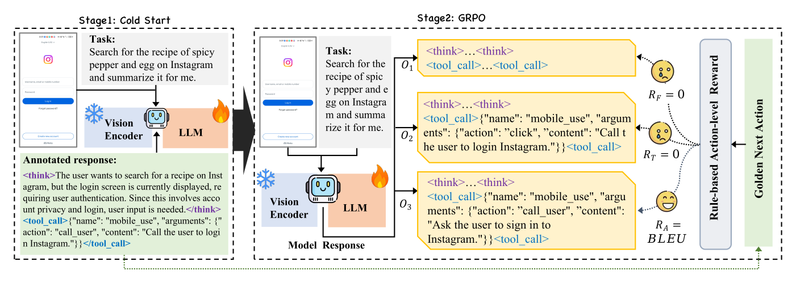
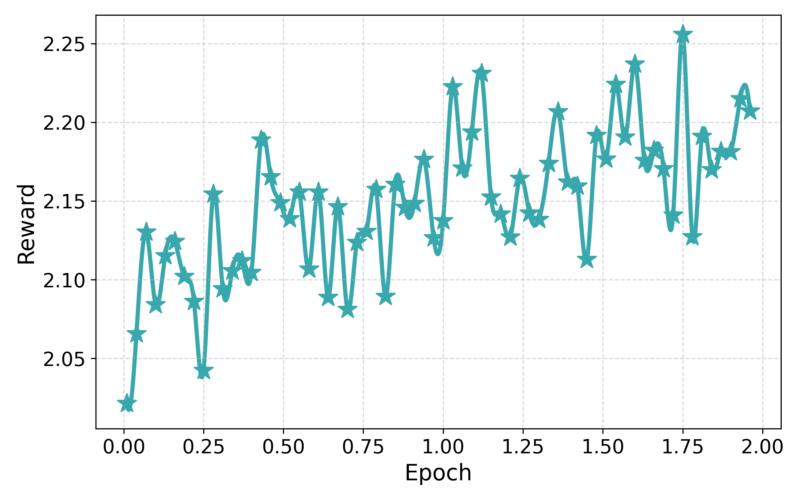

# InquireMobile

> **InquireMobile: Teaching VLM-based Mobile Agent to Request Human Assistance via Reinforcement Fine-Tuning**

[](LICENSE)
[](LICENSE-DATA)
[](https://aclanthology.org/2026.acl-long.1487/)

This is the official implementation of **InquireMobile** (ACL 2026).

**Project page:** <https://bit-aqh.github.io/InquireMobile/homepage/> · **Paper:** <https://aclanthology.org/2026.acl-long.1487/>

Recent advances in Vision-Language Models (VLMs) have enabled mobile agents to
perceive and interact with real-world mobile environments from human
instructions. The fully autonomous paradigm, however, poses safety risks when the
model's understanding or reasoning is insufficient. **InquireMobile** is an
interactive system that *actively seeks human confirmation at critical decision
points* instead of blindly acting — it learns to call the user (`call_user`) when
facing uncertain, sensitive, or ambiguous situations (e.g., login, payment,
privacy-related decisions).

## Overview

- **InquireBench** — a comprehensive benchmark for evaluating a mobile agent's
  safe interaction and proactive inquiry, spanning 5 categories and 22
  sub-categories, where most existing VLM-based agents score near zero.
- **Two-stage training** — supervised fine-tuning (SFT) followed by
  reinforcement fine-tuning (GRPO / RLVR), built on the
  [R1-V](https://github.com/Deep-Agent/R1-V) framework for verifiable-reward
  reinforcement learning in vision-language models.
- **Interactive pre-action reasoning** — the agent reasons *whether* to act or to
  request user assistance before each action.
- **Results** — **+46.8%** inquiry success rate and the best overall success rate
  among existing baselines on InquireBench.

## Repository structure

```
.
├── annotation/               # data annotation pipeline (GPT-4o pre-labelling, inquiry generation, translation)
├── data/                     # dataset download script (data is hosted on Hugging Face)
├── prompts/                  # agent system prompt / action space
├── R1-V/                     # training code: fork of R1-V (GRPO / RLVR for VLMs)
│   └── src/r1-v/src/open_r1/
│       ├── grpo_interactive.py   # GRPO with the interactive (call_user) reward
│       ├── sft.py                # supervised fine-tuning
│       └── trainer/              # GRPO trainers
├── evaluation/
│   ├── eval.py               # model rollout + GPT-4o judge
│   ├── device_runner.py      # executes actions on an Android device / emulator (ADB)
│   └── summarize_results.py  # SR / ISR / reward from result files
├── scripts/                  # launch scripts (training / evaluation)
├── results/                  # judge outputs of all models reported in the paper
├── assets/                   # figures
└── homepage/                 # project page
```

## Installation

```bash
git clone https://github.com/BIT-AQH/InquireMobile.git
cd InquireMobile

conda create -n inquiremobile python=3.11 -y
conda activate inquiremobile

# training dependencies (R1-V, vLLM, flash-attn, pinned transformers)
cd R1-V && bash setup.sh && cd ..

# evaluation / annotation dependencies
pip install -r requirements.txt
```

## Data

Training data, the InquireBench tasks and all screenshots are hosted on
Hugging Face: [PG23/InquireMobile](https://huggingface.co/datasets/PG23/InquireMobile).

```bash
bash data/download.sh              # -> data/InquireMobile/{data,images}
```

See [data/README.md](data/README.md) for the file list and schemas, and
[LICENSE-DATA](LICENSE-DATA) for the data license (CC BY 4.0).

## Training

<p align="center"></p>
<p align="center"><em>Two-stage training: Stage&nbsp;1 cold-start SFT on interaction-annotated
trajectories, then Stage&nbsp;2 GRPO with a rule-based action-level reward
(format <code>R<sub>F</sub></code>, task <code>R<sub>T</sub></code>, BLEU-based
inquiry <code>R<sub>A</sub></code>) against the golden next action.</em></p>

InquireMobile is trained from Qwen2.5-VL-3B in two stages:

1. **SFT** on the interaction-annotated trajectories
   (`data/InquireMobile/data/interactive_sft.jsonl`), with any standard
   Qwen2.5-VL fine-tuning pipeline.
2. **GRPO / RLVR** with the interactive (`call_user`) reward, implemented in
   [`grpo_interactive.py`](R1-V/src/r1-v/src/open_r1/grpo_interactive.py):

```bash
# from the merged SFT checkpoint
MODEL_NAME_OR_PATH=/path/to/sft/checkpoint-merge bash scripts/train_grpo_from_sft.sh

# or from a stage-1 checkpoint
MODEL_NAME_OR_PATH=/path/to/Qwen2.5-VL-3B-Inquire-Stage1 bash scripts/train_grpo_stage2.sh
```

Paths and the number of GPUs are controlled by environment variables
(`DATA_ROOT`, `OUTPUT_DIR`, `NUM_GPUS`, …); see the header of each script.

<p align="center"></p>

> Model checkpoints are released separately. *(TODO: add checkpoint links.)*

## Evaluation

Evaluation on InquireBench is *online*: the agent operates a real Android
device / emulator. It involves two processes that exchange screenshots and
actions through a shared OSS bucket:

```
┌──────────────────────────────┐   actions   ┌──────────────────────────────┐
│  evaluation/eval.py          │ ──────────► │  evaluation/device_runner.py │
│  (GPU server)                │             │  (machine with ADB device)   │
│  model rollout + GPT-4o judge│ ◄────────── │  executes actions, uploads   │
│  -> results/*.jsonl          │ screenshots │  screenshots                 │
└──────────────────────────────┘             └──────────────────────────────┘
```

### 1. Device runner

`evaluation/device_runner.py` watches the bucket for new actions, executes
them through ADB and uploads the resulting screenshots.

```bash
export OSS_ACCESS_KEY_ID="..."
export OSS_ACCESS_KEY_SECRET="..."
export OSS_ENDPOINT="..."
export OSS_BUCKET_NAME="..."
export OSS_PREFIX="gui_agent"           # key prefix inside the bucket
export ANDROID_SERIAL="..."             # `adb devices`

python evaluation/device_runner.py \
    --task_name eval_inquire_stage1_huawei_en \
    --devices huawei \
    --training_step 0 \
    --sample_num 1 \
    --max_steps 15 \
    --loop
```

| Argument | Description |
|---|---|
| `--task_name` | Experiment name; determines the OSS key prefix. |
| `--devices` | Logical device names (`huawei`, `device0`, …) mapped to ADB serials in the script. |
| `--serial` | Override the ADB serial of the selected devices. |
| `--training_step` | Starting instruction index (incremented before the first run). |
| `--sample_num` | Number of samples per instruction. |
| `--max_steps` | Maximum rollout steps. |
| `--image_base` / `--bbox_base` | Local directories for captured screenshots / bbox visualisations. |
| `--loop` | Keep moving on to the next instruction until interrupted. |

### 2. Model rollout + judging

`evaluation/eval.py` loads a Qwen2.5-VL (or UI-TARS) checkpoint, interacts with
the device through the mounted bucket (`--oss_base`) and scores every
trajectory with a GPT-4o-compatible judge.

```bash
export OPENAI_API_KEY="..."
export OPENAI_BASE_URL="..."            # your judge endpoint

python evaluation/eval.py \
    --model_path /path/to/Qwen2.5-VL-3B-Inquire-Stage1 \
    --eval_dataset_path data/InquireMobile/data/tasks_en_huawei.jsonl \
    --eval_result_path results/runs/eval_inquire_stage1_huawei_en.jsonl \
    --task_name eval_inquire_stage1_huawei_en \
    --device huawei \
    --arch qwen2_5_vl \
    --oss_base /path/to/mounted/bucket/gui_agent \
    --max_steps 15
```

or simply `MODEL_PATH=... OSS_BASE=... bash scripts/eval.sh`.

| Argument | Description |
|---|---|
| `--model_path` | Model checkpoint (a PEFT adapter is merged automatically if present). |
| `--eval_dataset_path` | JSONL of `{"instruction", "category", "intension"}` items. |
| `--eval_result_path` | JSONL of per-task judge results (`reason`, `reward`, `status`, `inquiry`). |
| `--task_name` / `--device` | Must match the device runner; locate the run under `--oss_base`. |
| `--arch` | `qwen2_5_vl` (default) or `ui_tars` (Qwen2-VL). |
| `--oss_base` | Local mount of `oss://<bucket>/<OSS_PREFIX>` holding `images/` and `instructions/`. |
| `--api_key` / `--api_url` / `--judge_model` | Judge settings (default: `OPENAI_API_KEY`, `OPENAI_BASE_URL`, `gpt-4o-0806`). |

The result file is append-only: already-evaluated instructions are skipped on
restart, so a run can be resumed safely.

### 3. Metrics

```bash
python evaluation/summarize_results.py results/en/*.jsonl results/zh/*.jsonl
```

prints the task success rate (SR), the inquiry success rate (ISR) and the mean
judge reward. The judge outputs for all models reported in the paper are
provided in [`results/`](results/README.md).

## Data annotation

The scripts in [`annotation/`](annotation/) reproduce the annotation pipeline
(they expect `OPENAI_API_KEY` / `OPENAI_BASE_URL`):

1. `judge_interaction.py` — GPT-4o pre-labels whether a screenshot/instruction
   pair requires user interaction (later verified by human annotators);
2. `generate_inquiry.py` — generates the reasoning and `call_user` content for
   interactive samples;
3. `translate.py` — translates the annotations into Chinese.

## Acknowledgement

The training code is built on [R1-V](https://github.com/Deep-Agent/R1-V)
(Apache-2.0); see [`R1-V/README.md`](R1-V/README.md).

## License

- **Code**: [MIT License](LICENSE)
- **Data**: [CC BY 4.0](LICENSE-DATA)

## Citation

```bibtex
@inproceedings{ai-etal-2026-inquiremobile,
    title = "{I}nquire{M}obile: Teaching {VLM}-based Mobile Agent to Request Human Assistance via Reinforcement Fine-Tuning",
    author = "Ai, Qihang  and
      Bu, Pi  and
      Cao, Yue  and
      Wang, Yingyao  and
      Gu, Jihao  and
      Xing, Jingxuan  and
      Zhu, Zekun  and
      Jiang, Wei  and
      Zheng, Zhicheng  and
      Song, Jun  and
      Jiang, Yuning",
    editor = "Liakata, Maria  and
      Moreira, Viviane P.  and
      Zhang, Jiajun  and
      Jurgens, David",
    booktitle = "Proceedings of the 64th Annual Meeting of the {A}ssociation for {C}omputational {L}inguistics (Volume 1: Long Papers)",
    month = jul,
    year = "2026",
    address = "San Diego, California, United States",
    publisher = "Association for Computational Linguistics",
    url = "https://aclanthology.org/2026.acl-long.1487/",
    doi = "10.18653/v1/2026.acl-long.1487",
    pages = "32241--32255",
    ISBN = "979-8-89176-390-6",
    abstract = "Recent advances in Vision-Language Models (VLMs) have enabled mobile agents to perceive and interact with real-world mobile environments based on human instructions. However, the current fully autonomous paradigm poses potential safety risks when model understanding or reasoning capabilities are insufficient. To address this challenge, we first introduce \textbf{InquireBench}, a comprehensive benchmark specifically designed to evaluate mobile agents' capabilities in safe interaction and proactive inquiry with users, encompassing 5 categories and 22 sub-categories, where most existing VLM-based agents demonstrate near-zero performance. In this paper, we aim to develop an interactive system that actively seeks human confirmation at critical decision points. To achieve this, we propose \textbf{InquireMobile}, a novel model inspired by reinforcement learning, featuring a two-stage training strategy and an interactive pre-action reasoning mechanism. Finally, our model achieves an 46.8{\%} improvement in inquiry success rate and the best overall success rate among existing baselines on InquireBench. The project page is available at \url{https://bit-aqh.github.io/InquireMobile/homepage/}."
}
```
